# New Breakthrough in Anti-Interference: Two-Dimensional DOA Estimation Scheme with Sparse Billboard Array and T-shaped Array [with MATLAB Code]

Anti-interference Breakthrough: Sparse Billboard Array and T-shaped Array for Two-Dimensional DOA Estimation
In the field of array signal processing, two-dimensional direction of arrival (2D-DOA) estimation is a core technology in radar detection, electronic reconnaissance, wireless communication positioning, and other systems. While traditional planar arrays can simultaneously calculate azimuth and elevation angles, the dense arrangement of elements often leads to severe mutual coupling effects, directly limiting estimation accuracy and system resolution capabilities.
Recently, a research team from King Fahd University of Petroleum and Minerals in Saudi Arabia proposed two new types of sparse planar array architectures - the sparse Billboard array and the sparse T-shaped array. The team expanded the one-dimensional sparse array concept to two dimensions, significantly enhancing the number of distinguishable sources based on the fourth-order difference covariance (FODC) theory while substantially reducing the impact of mutual coupling between elements. These findings have been published in the IEEE Open Journal of Signal Processing.
Research Background and Problem Proposed
The performance limit of DOA estimation is tightly bound to the depth of array topology structure. Among existing two-dimensional array systems, structures such as uniform rectangular arrays, L-shaped arrays, cross-shaped arrays, Billboard arrays, and T-shaped arrays have been widely studied. However, most uniformly arranged arrays face two major challenges:
1. Mutual coupling effect is significant: The minimum distance between elements is only half a wavelength, and electromagnetic coupling between neighboring elements can distort the received signal, degrading estimation accuracy;
2. Freedom is limited: The number of distinguishable sources that can be simultaneously resolved is limited by the physical number of elements, making it difficult to meet the needs of underdetermined estimation scenarios.
To break through these bottlenecks, sparse arrays and difference covariance theory have become mainstream technical paths:
Second-order difference covariance (SODC) has been extensively applied in the sparse modification of L-shaped and cross-shaped arrays, allowing the number of distinguishable sources to exceed the physical number of elements;
Fourth-order difference covariance (FODC) can further tap into the potential of virtual elements, achieving higher freedom but corresponding two-dimensional array design remains insufficient.
Existing structures such as sandglass arrays and two-dimensional nested arrays have either high mutual coupling weights or holes in the common array leading to insufficient degrees of freedom. To address this issue, this paper expands mature one-dimensional sparse arrays (coprime arrays, nested arrays, and super-nested arrays) into Billboard and T-shaped two-dimensional architectures, designing a new array system that combines high degrees of freedom with low mutual coupling characteristics.
II. Design of the New Sparse Array Structure
The core design concept of this paper is to replace traditional uniform linear subarrays in both the Billboard and T-shaped arrays with one-dimensional sparse arrays, while preserving the advantages of the original architecture and reducing the density of elements and suppressing mutual coupling effects.
1. Sparse Billboard Array: The prototype of the Billboard array consists of three subarrays intersecting at the origin: along the x-axis, y-axis, and the diagonal line y=x. This paper replaces these three uniform subarrays with three types of one-dimensional sparse arrays, resulting in three types of Billboard structures:
Coprime Base Billboard Array: The subarrays are structured as coprime arrays, consisting of two uniform subarrays with numbers and respectively, separated by distances and total physical elements count;
Nested Base Billboard Array: The subarrays adopt a rotated nested array structure, achieving a large aperture through the cascade of dense and sparse subarrays, with total elements count;
Super-Nested Base Billboard Array: On top of the nested array, some elements are rearranged to further reduce the mutual coupling in the dense area, maintaining the same total number of elements as the nested base structure.
2. Sparse T-Shaped Array: The prototype of the T-shaped array consists of three subarrays along the positive half-axis, negative half-axis, and the positive half-axis of the x-axis (shared elements at the origin). Similarly, replacing these three subarrays with sparse linear arrays results in three corresponding sparse T-shaped arrays.
Compared to the Billboard array, the T-shaped array forms a symmetric distribution along the x-axis, allowing for greater common array aperture and higher continuous degrees of freedom. Under the same physical element count, the number of distinguishable sources in the T-shaped structure generally exceeds that of the Billboard structure.
3. Theoretical Model of Two-Dimensional DOA Estimation
1. Received Signal Model Assumption: A distant uncorrelated narrowband source impinges on the array, with the azimuth angle and elevation angle of each source being respectively and . The received signal vector from the array can be expressed as: where , is the normalized direction of arrival (DOA), is the array manifold matrix, and is zero-mean Gaussian white noise.
2. Fourth Order Cumulants and Fourth Order Difference Covariance Matrix (FODC) for Higher Order Freedom: In this paper, we use the fourth order cumulants to construct a virtual array. By constructing a fourth order cumulant matrix and vectorizing it, equivalent virtual array observations are obtained, whose corresponding virtual element positions are determined by the Fourth Order Difference Covariance Matrix (FODC).
In physical terms, the Fourth Order Difference Covariance Matrix is a virtual position difference operation on the Second Order Difference Covariance Matrix, equivalent to the combination of the Second Order and Difference Covariance Matrix, which can generate more virtual elements than the Second Order Covariance Matrix itself, thereby achieving higher source resolution than the physical number of elements.
3. Estimation Algorithm Process:
1. Calculate the fourth order cumulant matrix and vectorize it to obtain the virtual array observation vector;
2. Extract the largest continuous uniform rectangular array (URA) fragment from the Fourth Order Difference Covariance Matrix to eliminate hole effects on estimation;
3. Use the two-dimensional unitary ESPRIT algorithm to achieve automatic pairing and closed-form estimation of azimuth and elevation angles.
4. Core Performance Indicators and Theoretical Derivation: This paper systematically derives closed-form expressions for key indicators such as uniform freedom, array aperture, and weight function in six types of array structures, and extends the Cramér-Rao bound (CRB) under the framework of Fourth Order Covariance Matrix.
1. Uniform Freedom (uDOF) in a covariance matrix determines the number of virtual elements that can be utilized in an actual uniformly free space, which is a core metric for assessing the ability of an array to estimate poorly defined signals. We derive:
T-shaped nested arrays achieve the highest uDOF, significantly outperforming traditional structures like hourglass arrays and two-dimensional nested arrays under similar physical element counts;
Interleaved base arrays can achieve maximum uDOF when their values are close to each other; while nested and super-nested arrays perform optimally when both and are equally divided among total elements.
Taking 22 physical elements as an example, the continuous virtual elements of a T-shaped nested array can reach up to 5929, significantly higher than that of a Billboard nested array at 2209.
2. Weight functions and mutual coupling characteristics describe the number of physical elements corresponding to each virtual position in the coherent array. The weight value corresponding to the minimum distance directly reflects the strength of mutual coupling: the smaller the weight, the fewer close-range element pairs, and the weaker the mutual coupling effect.
Mutual prime bases and super-nested base arrays have a constant minimum distance weight (not dependent on the number of elements), exhibiting excellent mutual coupling suppression capabilities;
Nested base arrays due to their dense subarrays, have weight values that linearly increase with the number of elements, resulting in relatively severe mutual coupling;
The weight value along the diagonal of a T-shaped structure is 0, further reducing the impact of cross-coupling.
3. CRB under four-order coherent arrays This paper derives the Cramer-Rao bound (CRB) for two-dimensional direction of arrival (DOA) estimation based on the fourth cumulant model, providing a theoretical benchmark for performance evaluation. The results indicate that even if the coherent array scale is the same, different physical element distributions can lead to differences in CRB, and the array topology has a direct impact on the lower bound of estimation accuracy.
Fifth, simulation verification and core conclusions The research team conducted extensive Monte Carlo simulations to compare the performance of six types of arrays from estimation accuracy, anti-interference capability, computational complexity, etc.
1. Ideal scenario without mutual coupling In the absence of mutual coupling effects, the T-shaped nested array achieves the lowest root mean square error (RMSE) under high signal-to-noise ratio (SNR) by having the highest uDOF; all proposed arrays outperform traditional hourglass arrays and can reliably distinguish sources beyond the physical array size of 22 elements.
2. Realistic scenario with mutual coupling After introducing mutual coupling, there is a significant change in performance ranking:
Super-nested bases and mutual prime base arrays demonstrate strong robustness against mutual coupling, maintaining stable estimation performance even under strong mutual coupling intensity;
Nested base arrays, despite having the highest degrees of freedom, suffer severely from mutual coupling, with estimation accuracy showing a clear bottleneck under high SNR;
Overall, the T-shaped structure has better anti-interference capability than the Billboard structure, among which the comprehensive performance of the T-shaped super-nested array is the most outstanding.
3. The computational complexity of the array is positively correlated with uDOF. The Billboard super-nested array has the fastest computation time, while the T-shaped nested array has the longest computation time due to the largest scale of virtual elements.
VI. Summary of the full text This paper proposes six kinds of sparse planar array architectures, which provide systematic solutions for mutual coupling suppression and degree of freedom enhancement in two-dimensional DOA estimation.
1  
Architecture Innovation: The one-dimensional sparse array concept is fully extended to the Billboard and T-shaped two-dimensional architectures, forming a sparse design system that covers three types of bases: coprime, nested, and super-nested.
2  
Theoretical sufficiency: Derived the closed-form expressions for all array elements' positions, continuous degrees of freedom, and array aperture in all arrays. Furthermore, the CRB formula under the four-order covariance matrix system was extended, providing theoretical basis for engineering selection.
3  
Scenario Compatibility: In an ideal non-coupling scenario, nested base arrays have the highest degree of freedom. In strong coupling scenarios, coprime and super-nested base arrays exhibit robustness, allowing for flexible selection based on actual engineering constraints.
This study provides new ideas for the design of low-coupling, high-freedom 2D arrays, which have important application value in radar detection, electronic reconnaissance, and 6G integrated positioning.

## Images

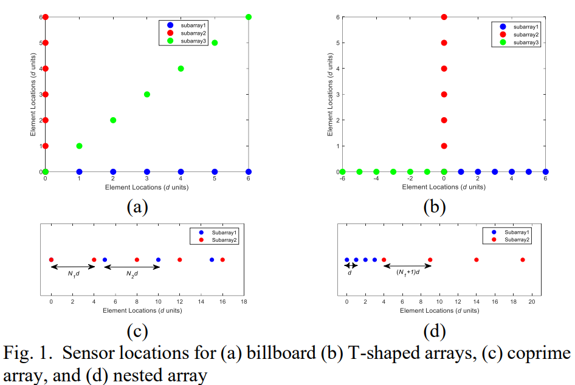
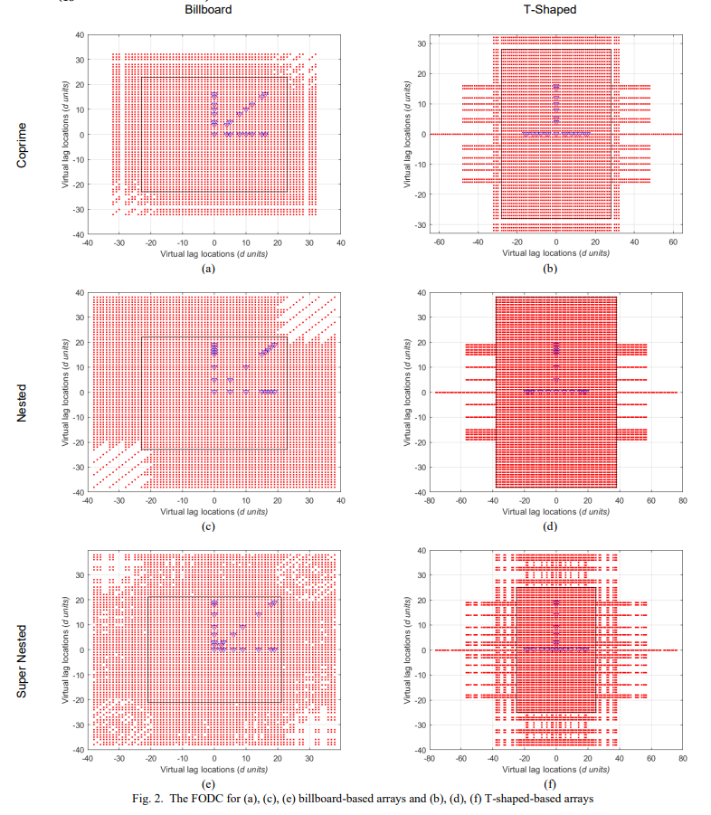
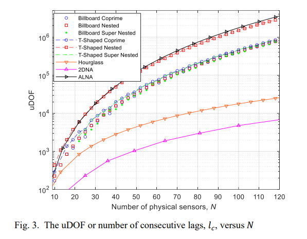
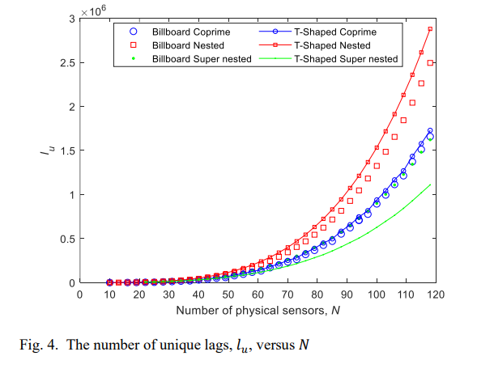
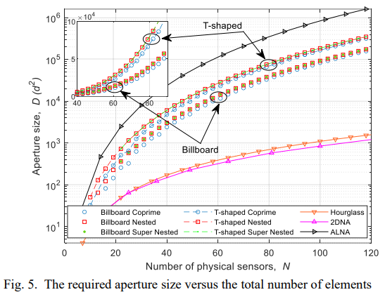
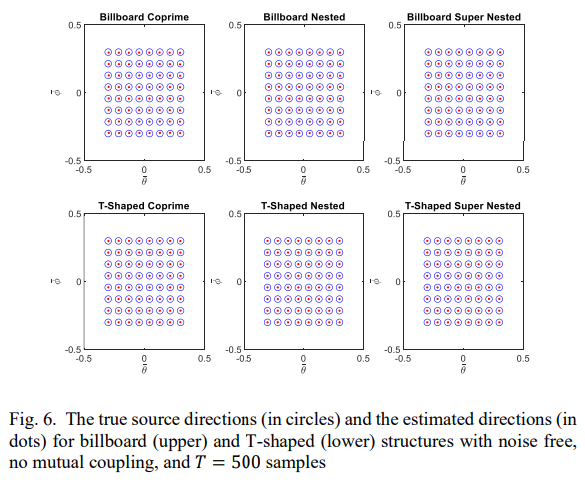
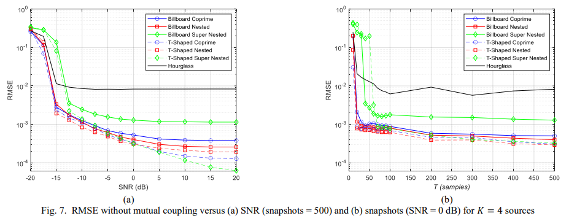
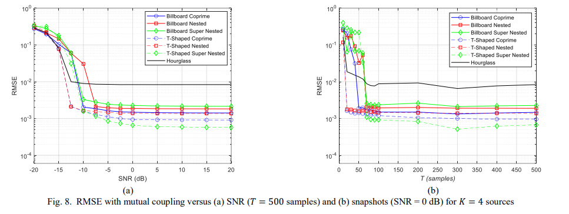
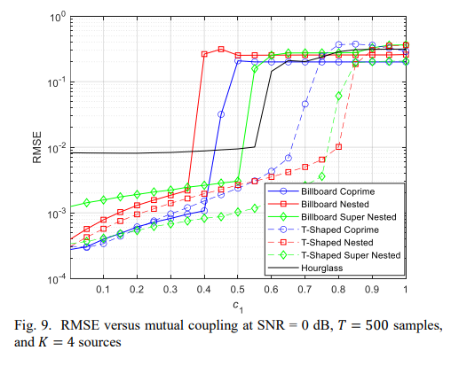
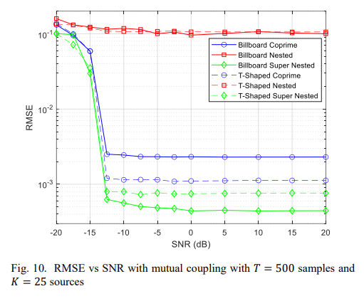
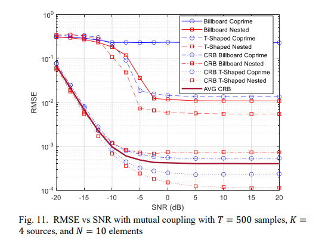

<!-- PAYMENT_BLOCK -->

## Get this dataset

- Payment link (Stripe): [Buy now](https://buy.stripe.com/3cs8yP7sY87d0vu9AB)
- Payment QR code: 

<!-- /PAYMENT_BLOCK -->
